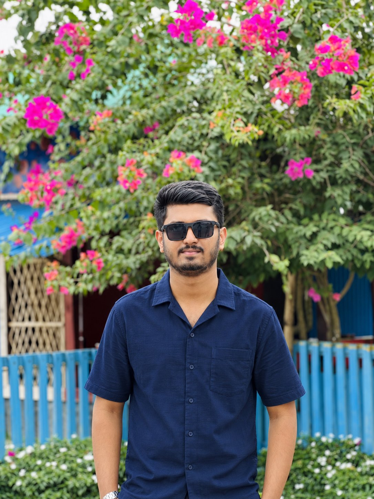

  

<h1 align="center">Hi 👋, I'm Argha Paul</h1>

  

  

## 🙋‍♂️ About Me

- 🎓 Pursuing **B.Sc. in CSE at Saic Institute of Management and Technology (SIMT), Technology Unit, University of Dhaka**
- 🆔 Student ID: **CSE-2324001** | Session: **2023–24**
- 🌱 Currently learning **Data Structures & Algorithms, Database Management Systems and Computer Networking**
- 🔭 Currently building a **CSE Quiz Platform** with React, Node.js and MySQL
- 💬 Ask me about **C, C++, Java, JavaScript, OOP and SQL**
- 📫 Reach me through my GitHub profile: **https://github.com/arghapaul01**
- 📍 Mirpur, Dhaka, Bangladesh

## 🎓 Education

| Item | Detail |
| --- | --- |
| Degree | B.Sc. in Computer Science & Engineering |
| Institute | Saic Institute of Management and Technology (SIMT) |
| Affiliation | Technology Unit, University of Dhaka |
| Session | 2023–24 |
| Student ID | CSE-2324001 |
| Location | Mirpur, Dhaka-1216, Bangladesh |

## 💻 Tech Stack

**Languages**

**Web Development**

**Tools**

## 📚 Core CSE Focus

- **Programming:** C, C++, Java and JavaScript — with a strong focus on Object-Oriented Programming (OOP)
- **Data Structures & Algorithms:** Stack, Queue, Linked List, Sorting and Dynamic Programming
- **Database:** DBMS concepts, Relational Algebra and SQL
- **Networking:** Computer networking fundamentals, IPv4 and IPv6

## 🚀 Featured Project

### CSE Quiz Platform

A full-stack quiz platform for CSE students, built as a university project.

- **Frontend:** React with Redux — individual login, animated home and result pages
- **Backend:** Node.js with a REST API
- **Database:** MySQL
- **Highlights:** A large pre-set question bank on Programming, Database and Networking; every attempt draws a fresh random set of 30 questions, explanations for wrong answers, marks and ranking, a Live Group Quiz mode, and an Admin Dashboard

## 📊 GitHub Stats

  

  

  

## 📈 Activity Graph

  

## 🎯 Current Goals

- 🎓 Complete my B.Sc. in CSE with a strong grip on core subjects
- 💻 Get stronger in **Data Structures & Algorithms, DBMS and Computer Networking**
- 🚀 Finish and publish the **CSE Quiz Platform** — React, Node.js and MySQL
- 🌱 Keep building and pushing projects on GitHub, one project at a time

## ⚡ Fun Fact

- Every attempt on my CSE Quiz Platform draws a fresh random set of questions — so no two attempts ever get the same set.

## 🐍 Contribution Snake

<picture>
  <source media="(prefers-color-scheme: dark)" srcset="https://raw.githubusercontent.com/arghapaul01/arghapaul01/output/github-contribution-grid-snake-dark.svg" />
  <source media="(prefers-color-scheme: light)" srcset="https://raw.githubusercontent.com/arghapaul01/arghapaul01/output/github-contribution-grid-snake.svg" />
  
</picture>

## 🤝 Connect With Me

- 💼 GitHub: https://github.com/arghapaul01

---

<i>Developed by Argha Paul — B.Sc. in CSE, Dept. of CSE, SIMT</i>

